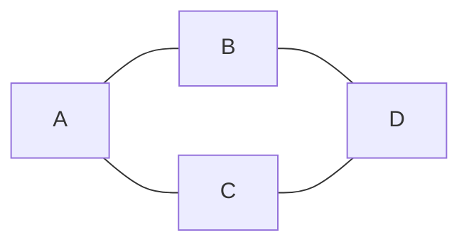
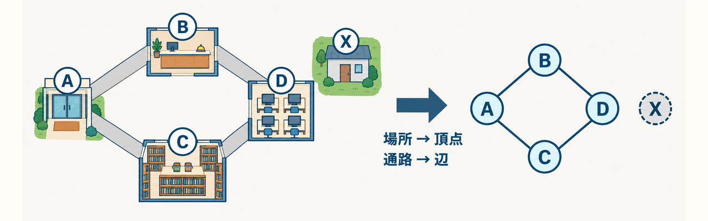
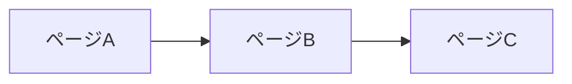
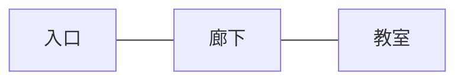
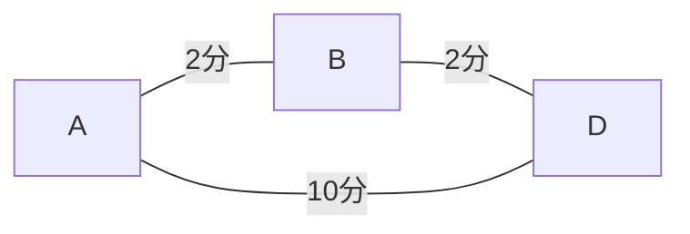
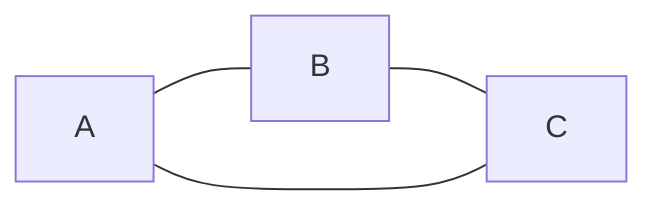
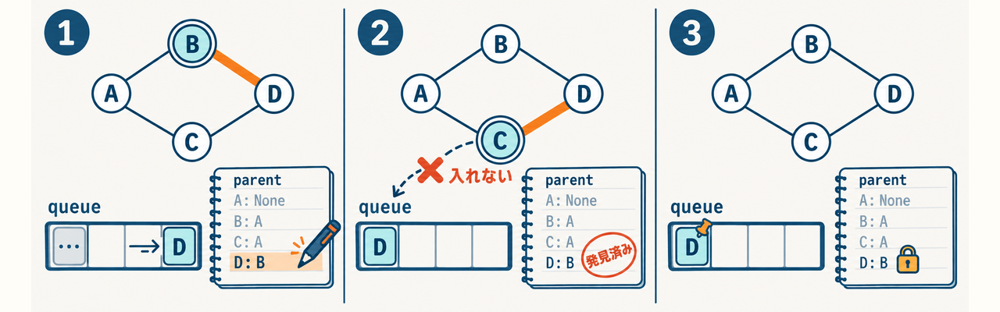

<div class="eyebrow">SOFTWARE DESIGN 2026 / 05</div>

# グラフによる<br>問題の表現

## 関係をデータにし、経路を探す

情報システム学科 3年 / 選択2単位

---
class: learning05
---

<LearningStyles05 />

# 今日の到達目標

- 実際の関係を頂点と辺として表現できる
- 向きと重みの意味を、問題の条件から決められる
- BFSの訪問済み管理と経路復元を説明できる

次回の経路探索演習に使う設計を、自分の言葉で書きます。

---
class: learning05
---

<LearningStyles05 />

# 前回との接続

木の探索では、親子関係を一方向にたどりました。

グラフでは、同じ頂点へ複数の経路で到達することがあります。

<div v-if="false" class="sd-figure-reference">



</div>

<Graph05 variant="diamond" />

訪問済みを管理すると、同じ頂点の重複処理と、循環による繰り返しの探索を防げます。

---
class: learning05
---

<LearningStyles05 />

# グラフ理論とは

グラフ理論は、対象と対象のつながりを **頂点** と **辺** で抽象化し、到達・経路・連結などの構造の性質を調べる数学の分野です。

| 呼び名 | 表すもの |
| --- | --- |
| 折れ線グラフ・棒グラフ | 数値の変化や大小を、軸の上に描いた図 |
| この回のグラフ | ものとものの間のつながりそのもの |

同じ「グラフ」という言葉でも別物です。この回は、つながりの構造だけを扱います。

---
class: learning05
---

<LearningStyles05 />

# 頂点と辺

グラフ G = (V, E) は、頂点の集合Vと辺の集合Eで関係を表します。

| 題材 | 頂点 | 辺 |
| --- | --- | --- |
| 校内の移動 | 場所 | 通れる区間 |
| Webサイト | ページ | リンク |
| 作業の依存 | 作業 | 前提となる関係 |
| 友人関係 | 人 | 相互の関係 |

何を1頂点とするかが、モデルの粒度を決めます。

---
class: learning05
---

<LearningStyles05 />

# 頂点・辺・隣接の言葉

頂点は対象を、辺は2つの頂点のつながりを表します。

| 用語 | 意味 | 校内マップの例 |
| --- | --- | --- |
| 頂点 vertex | 対象1つ | 場所A、B、C、D、X |
| 辺 edge | 2頂点のつながり1つ | 通路A–B |
| 隣接 | 1本の辺で直接つながる | AとB（AとDは隣接しない） |
| 孤立頂点 | 辺が1本もない頂点 | X |

頂点を節点・ノード（node）と呼ぶ資料もあります。公開コードの変数名は `vertex` です。

---
class: learning05
---

<LearningStyles05 />

# この回の前提：単純無向グラフ

主例のマップは、次の3つを満たす **単純無向グラフ** です。

| 前提 | このマップでは |
| --- | --- |
| 自己ループなし | A–Aのように自分へ戻る辺はない |
| 重複辺なし | AとBの間の辺は1本だけ |
| 向きなし | どの通路も両方向に通れる |

公開 `graphs.py` の探索は、自己ループや重複辺を含む入力でも、訪問済みの管理で終了します。これは実装が壊れないという性質で、モデルの前提とは別の話です。

---
class: learning05
---

<LearningStyles05 />

# モデルの境界

校内の「最短経路」でも、目的によって辺の意味が変わります。

- 通路の数を減らす：各辺を1区間として数える
- 移動時間を減らす：各辺に時間を持たせる
- 階段を避ける：通行可能な辺を限定する

要求を確認してから、必要なデータを決めます。

---
class: learning-course diagram-page
---

<LearningStylesCourse />

# 場所と通路から、頂点と辺を残す



第5回演習の架空マップです。1本の通路を1辺と数え、距離や時間は表しません。<br>
場所の絵とグラフを対応させ、今回の要求に不要な情報を1つ挙げます。

---
class: learning05
---

<LearningStyles05 />

# 現物の関係からデータへ

| 手順 | 校内マップでの決め方 |
| --- | --- |
| 1. 関係を選ぶ | 直接行き来できる通路 |
| 2. 問いを決める | AからDへ最少何回の移動で行けるか |
| 3. 1頂点・1辺を決める | 場所1つを1頂点、通路1本を1辺 |
| 4. データにする | 全頂点をキーに持つ隣接リスト |

前の図で、場所の位置や線の長さは距離・時間のデータではありません。BとCの上下を入れ替えても、同じグラフです。

---
class: learning05
---

<LearningStyles05 />

# 有向グラフ

辺に向きがあります。AからBへ行けても、BからAへ行けるとは限りません。

<div v-if="false" class="sd-figure-reference">



</div>

<Graph05 variant="directed" />

例：一方通行、ページのリンク、作業の依存。

---
class: learning05
---

<LearningStyles05 />

# 無向グラフ

辺の両方向に移動できます。

<div v-if="false" class="sd-figure-reference">



</div>

<Graph05 variant="undirected" />

隣接リストでは、Aの隣にBを書くと同時に、Bの隣にもAを書きます。

---
class: learning05
---

<LearningStyles05 />

# 重み付きグラフ

辺に距離・時間・料金などの値を持たせます。

<div v-if="false" class="sd-figure-reference">



</div>

<Weighted05 />

AからDへは、1辺の経路が10分、2辺の経路が4分です。

BFSは辺数が最少の経路を選びます。<br>
全辺が同じ正の費用なら、最短時間の経路にもなります。

---
class: learning05
---

<LearningStyles05 />

# BFSが最小費用にもなる条件

BFSが保証するのは辺数の最少です。費用の最小とは、条件付きで一致します。

| 各辺の費用 | BFSの経路は最小費用か |
| --- | --- |
| すべて1（移動1回） | はい。費用＝辺数 |
| すべて同じ正の値c | はい。費用＝c×辺数 |
| 2分と10分が混在 | 保証しない（前の図の例） |
| 0や負の値を含む | 保証しない |

重み付きの最小費用には別の方法が必要です。この回では実装しません。

---
class: learning05
---

<LearningStyles05 />

# 隣接リスト

各頂点について、直接つながる頂点を持ちます。

<div class="two-col" style="--left:440px">
<div>

```python
graph = {
    "A": ["B", "C"],
    "B": ["A", "D"],
    "C": ["A", "D"],
    "D": ["B", "C"],
    "X": [],
}
```

</div>
<div>

<Graph05 variant="adjacency" />

</div>
</div>

孤立した頂点Xも明示します。頂点集合を、辺だけから推測しません。

---
class: learning05
---

<LearningStyles05 />

# graph の辞書が表すもの

`graph` は dict（対応表）で、キーが頂点名、値が隣接先の list です。

| 式 | 値と意味 |
| --- | --- |
| `list(graph)` | `['A', 'B', 'C', 'D', 'X']`：全頂点 |
| `graph["A"]` | `['B', 'C']`：1辺で行ける頂点だけ |
| `graph["X"]` | `[]`：定義済みで、隣がない |
| `graph["Z"]` | KeyError：未定義（公開関数は先にValueError） |

`graph["A"]` は、到達できる全頂点でも経路でもありません。Dは2辺先なので入りません。

---
class: learning05
---

<LearningStyles05 />

# 集合と隣接リストで数える

グラフ G = (V, E) を、このマップで数えます。

| 見方 | このマップ |
| --- | --- |
| 頂点集合V | {A, B, C, D, X}：5個 |
| 辺集合E | {A, B}、{A, C}、{B, D}、{C, D}：4本 |
| 隣接リストの項目 | 2 + 2 + 2 + 2 + 0 = 8個 |
| 関係 | 8 = 2 × 4。1本を両端に1回ずつ書く |

無向辺 {A, B} は {B, A} と同じ1本です。集合の括弧は順序を持ちません。

---
class: learning05
---

<LearningStyles05 />

# 次数

単純無向グラフでは、頂点につながる辺の数を次数と呼びます。

有向グラフでは、出ていく辺を **出次数**、入ってくる辺を **入次数** として数えます。

```python
directed = {"A": ["B"], "B": ["D"], "D": []}
print(len(directed["A"]))  # Aの出次数は1
```

次数の値に正負の符号がある、という意味ではありません。

---
class: learning05
---

<LearningStyles05 />

# 隣接行列との比較

行と列を頂点に対応させ、接続の有無を格納します。

| 表現 | 記憶量の目安 | 得意な操作 |
| --- | --- | --- |
| 隣接リスト | O(V + E) | 隣の頂点の列挙 |
| 隣接行列 | O(V²) | 特定の2頂点の接続確認 |

Vは頂点数、Eは辺数です。無向リストでは各辺を両方向に持ちます。

辺が少ないグラフでは、隣接リストが使いやすくなります。

---
class: learning05
---

<LearningStyles05 />

# 経路と距離

経路は、隣り合う頂点どうしが辺で結ばれた頂点の列です。

`A, B, D` の辺数は **2** です。頂点数は3です。

- この回の距離は、移動した辺の数
- 最短経路が複数あることもある
- 同じ長さなら、隣接リストの順が返す経路に影響する

期待値は「長さ」と「経路の妥当性」の両方で確認します。

---
class: learning05
---

<LearningStyles05 />

# 循環

途中で同じ頂点も同じ辺も繰り返さずに、出発点へ戻る閉じた経路です。<br>単純無向グラフでは、異なる3頂点以上が必要です。

<div v-if="false" class="sd-figure-reference">



</div>

<Graph05 variant="cycle" />

訪問済みを管理しない探索は、同じ頂点を繰り返し処理することがあります。

無向グラフの循環判定では、直前の親へ戻る辺と、それ以外の再訪を区別します。

---
class: learning05
---

<LearningStyles05 />

# 循環になる列、ならない列

循環を判定するときは、同じ辺の往復と区別します。

| 頂点の列 | 循環か | 理由 |
| --- | --- | --- |
| A, B, D, C, A | 循環 | 別々の辺AB・BD・DC・CAで戻る |
| A, B, A | 循環ではない | 同じ辺ABを往復しただけ |
| A, B, D, B, A | 循環ではない | 辺AB・BDを往復しただけ |

往復は循環に数えません。そのため、循環のない木の上でも A, B, A の往復は起こります。

---
class: learning05
---

<LearningStyles05 />

# 木：循環のない連結グラフ

木は、連結で循環のない無向グラフです。第04回は根Aを決め、`children` で子だけをたどる表現でした。ここではA・B・Cだけの小さな木を例にします。

```python
tree = {"A": ["B", "C"], "B": ["A"], "C": ["A"]}
```

この3頂点の木を無向の隣接リストにすると、Bの隣にAが入ります。判定なしのBFSは、Aを何度もキューへ戻して終わりません。

この往復は循環ではありませんが、訪問済みの判定は必要です。「木なら不要」とは一般化しません。

---
class: learning05
---

<LearningStyles05 />

# 連結性と到達可能性

無向グラフが連結なら、どの頂点の組にも経路があります。

- Xが孤立していれば、全体は非連結
- BFSで到達した集合を求められる
- 有向グラフでは、出発点ごとに到達できる集合が変わる

有向グラフの「全頂点から互いに到達できる」は、強連結という別の条件です。

---
class: learning05
---

<LearningStyles05 />

# 探索する問題の仕様

**入力**：隣接リスト、出発点start、到着点goal。

**出力**：最少辺数の経路1本。到達できなければ `None`。

- 出発点と到着点が同じなら `[start]`
- 未知の頂点名は入力エラーとして扱う
- この演習は重みなし・無向グラフ

到達不能と入力エラーを区別します。

---
class: learning05
---

<LearningStyles05 />

# 呼出しと3種類の結果

`g = DEMO_GRAPH` として、`shortest_path(graph, start, goal)` を呼びます。

| 呼出し | 結果 | 意味 |
| --- | --- | --- |
| `shortest_path(g, "A", "D")` | `['A', 'B', 'D']` | 最少2辺 |
| `shortest_path(g, "A", "A")` | `['A']` | 0辺の経路 |
| `shortest_path(g, "A", "X")` | `None` | 到達不能 |
| `shortest_path(g, "A", "Z")` | `ValueError` | 入力エラー |

Xは定義済みで孤立した頂点、Zはどこにも定義がない名前です。

---
class: learning05
---

<LearningStyles05 />

# 探索の前に入力を確かめる

`shortest_path` の冒頭の抜粋です。関数の中なので、この3行だけでは実行できません。

```python
    validate_graph(graph)
    if start not in graph or goal not in graph:
        raise ValueError("始点と終点は定義済みの頂点にしてください")
```

型注釈 `dict[str, list[str]]` や `list[str] | None` は読み手への約束で、実行時の検査ではありません。だから未定義の名前を、ここで止めます。

---
class: learning05
---

<LearningStyles05 />

# 幅優先と深さ優先

名前は、候補をどちらへ先に広げるかを表します。

| 探索 | 候補の入れ物 | 取り出す順 |
| --- | --- | --- |
| BFS 幅優先（breadth-first） | queue（キュー） | FIFO（先入れ先出し）：先に入れた候補から |
| DFS 深さ優先（depth-first） | stack（スタック） | LIFO（後入れ先出し）：最後に入れた候補から |

BFSは近い層を広げ切ってから次の層へ進みます。DFSは1本の枝を奥まで進んでから戻ります。

---
class: learning05
---

<LearningStyles05 />

# deque の基本操作

`collections.deque` は、両端から出し入れできる列です。次は確認用の短い例です。

```python
from collections import deque
queue = deque(["A"])
queue.append("B")
queue.append("C")
print(queue.popleft())  # A
print(queue.pop())      # C
```

`append` は右端へ追加します。`popleft` は左端（最も古い候補）、`pop` は右端（最も新しい候補）を取り出します。BFSは `popleft` を使います。

---
class: learning05
---

<LearningStyles05 />

# BFSの層

キューを使うと、出発点から近い距離の順に処理します。

<div v-if="false" class="sd-figure-reference">

| 距離 | 頂点 |
| --- | --- |
| 0 | A |
| 1 | B, C |
| 2 | D |
| 到達不能 | X |

</div>

<BfsLayers05 />

未発見の頂点へ伸ばす辺は、現在の距離に1を足します。

---
class: learning05
---

<LearningStyles05 />

# FIFOだと距離の順になる理由

AからDのBFSで、キュー（左が先頭）と各頂点の距離を並べます。

| 時点 | キュー | 距離 |
| --- | --- | --- |
| 開始 | A | 0 |
| Aを処理した後 | B, C | 1, 1 |
| Bを処理した後 | C, D | 1, 2 |
| Cを処理した後 | D | 2 |

距離1の頂点が先に出るので、最初にDを発見した辺B–Dで距離2が確定します。

---
class: learning05
---

<LearningStyles05 />

# 発見と処理を分ける

| 用語 | コード上の瞬間 | AからDの例 |
| --- | --- | --- |
| 発見 | previous に記録し、append する | Bの処理中にDを見つける |
| 処理 | popleft で取り出した後 | Dを取り出し、goalと判定 |

`shortest_path` は、取り出した `vertex` が `goal` かを判定します。

Dを発見した瞬間に止める実装も作れますが、それは別の仕様です。この回の公開コードとは混ぜません。

---
class: learning05
---

<LearningStyles05 />

# 発見時の記録

キューへ入れた時点で訪問済みにします。

```python
queue = deque([start])
parent = {start: None}
while queue:
    node = queue.popleft()
    for neighbor in graph[node]:
        if neighbor not in parent:
            parent[neighbor] = node
            queue.append(neighbor)
```

`parent` は発見済み集合と、直前の頂点の記録を兼ねます。<br>公開 `graphs.py` では、同じ役割の辞書を `previous` と呼びます。

---
class: learning05
---

<LearningStyles05 />

# 講義コードと公開コードの名前

前の頁は講義用の名前、`graphs.py` は公開版の名前です。働きは同じです。

| 役割 | 講義スライド | graphs.py |
| --- | --- | --- |
| 直前の頂点の辞書 | `parent` | `previous` |
| 取り出した頂点 | `node` | `vertex` |
| 復元中に今いる頂点 | `node` | `cursor` |
| 最後に逆順にする | `path.reverse()` | `path[::-1]` |

以後の `graphs.py` の抜粋は関数内の断片で、単体実行用ではありません。<br>抜粋は右の列、「経路の復元」の講義コードは左の列の名前で読みます。

---
class: learning05
---

<LearningStyles05 />

# BFSの初期状態

`shortest_path` の抜粋です。start が "A" なら、queue は A だけを持ちます。

```python
    queue = deque([start])
    previous: dict[str, str | None] = {start: None}
```

型注釈は「値が頂点名か None の辞書」を表します。`{start: None}` は辞書で、`_bfs` の `{start}` は集合です。

この None は「Aに前の頂点はない」という印です。最後の `return None`（到達不能）とは意味が違います。

---
class: learning05
---

<LearningStyles05 />

# while と popleft

```python
    while queue:
        vertex = queue.popleft()
        if vertex == goal:
```

`while queue:` は、キューが空でない間くり返します。空になれば、ループの後の `return None` へ進みます。

`popleft` で最も古い候補を `vertex` に入れ、goal かを判定します。goal なら経路の復元へ進みます。

---
class: learning05
---

<LearningStyles05 />

# 隣接先を1つずつ調べる

```python
        for neighbor in graph[vertex]:
            if neighbor not in previous:
                previous[neighbor] = vertex
                queue.append(neighbor)
```

`vertex` は処理中の頂点、`neighbor` はその隣接先を1つずつ受け取る変数です。

辞書の `in` はキーを調べます。`previous` にない未発見の頂点だけ、前の頂点を記録してから queue の末尾へ追加します。

---
class: learning05
---

<LearningStyles05 />

# Bを処理するときの値

queue が B, C の状態で、B を取り出した場面です。

| 変数・式 | 値 |
| --- | --- |
| `vertex` | `'B'` |
| `graph[vertex]` | `['A', 'D']` |
| `neighbor` が `'A'` | previous にあるので何もしない |
| `neighbor` が `'D'` | `previous['D'] = 'B'`、queue へ追加 |

取り出した直後の queue は C だけ、処理後は C, D です。

---
class: learning05
---

<LearningStyles05 />

# 訪問済みを記録する理由

BとCの両方からDへ行ける場合を考えます。

1. Bを処理してDを発見し、キューへ入れる
2. Cを処理したとき、Dはすでに発見済み
3. Dを再びキューへ入れず、最初の親を保つ

各頂点を1回だけキューへ入れれば、循環があっても探索を終了できます。

---
class: learning-course diagram-page
---

<LearningStylesCourse />

# 同じDを、2度登録しない



parentのノートは辞書の説明模型です。queueの「…」は省略した部分です。<br>
CからDを見たとき、queueとparentを変更しない理由を、図とコードで説明します。

---
class: learning05
---

<LearningStyles05 />

# 訪問済みの判定を外すと

仮に `if neighbor not in previous:` を外した場合を、表だけで追います。

| 取り出し | 起きること | 処理後のキュー |
| --- | --- | --- |
| A | B, C を追加 | B, C |
| B | A, D を追加。`previous['A']` が None から B に | C, A, D |
| C | A, D を追加。A と D の前が C に上書き | A, D, A, D |

キューは減らず、goal のない探索は終わりません。復元を止める None も消えます。

---
class: learning05
---

<LearningStyles05 />

# 経路の復元

到着点から親をたどり、最後に逆順にします。

<div class="two-col" style="--left:500px">
<div>

```python
path = []
node = goal
while node is not None:
    path.append(node)
    node = parent[node]
path.reverse()
```

</div>
<div>

<ParentChain05 />

</div>
</div>

`D` の親が `B`、`B` の親が `A` なら、結果は `A, B, D` です。

未到達のgoalを先に判定してから復元します。

---
class: learning05
---

<LearningStyles05 />

# 公開コードの経路復元

```python
        if vertex == goal:
            path = []
            cursor: str | None = goal
            while cursor is not None:
                path.append(cursor)
                cursor = previous[cursor]
            return path[::-1]
```

`cursor` は復元中に今いる頂点です。`previous[cursor]` で1つ前へ移り、Aの前の None で止まります。

`path[::-1]` は逆順の新しいリストを作り、それを返します。

---
class: learning05
---

<LearningStyles05 />

# 復元の状態変化

goal の D から、D → B → A → None の順にたどります。

| 回 | append した cursor | path |
| --- | --- | --- |
| 1回目 | `'D'` | `['D']` |
| 2回目 | `'B'` | `['D', 'B']` |
| 3回目 | `'A'` | `['D', 'B', 'A']` |
| 終了 | cursor が None | 逆順で `['A', 'B', 'D']` |

`reverse()` はその場で、`[::-1]` は新しいリストで逆順にします。結果は同じです。

---
class: learning05
---

<LearningStyles05 />

# 同じ頂点の場合と到達不能の場合

goal が start と同じ A なら、最初の `popleft` で `vertex == goal` です。`previous['A']` は None なので、結果は `['A']` です。

goal が X なら、X はどの隣接リストにもないので queue に入りません。queue が空になり、ループの後の `return None` へ進みます。

到達しない goal について `previous[goal]` を読まないので、KeyError も起きません。

---
class: learning05
---

<LearningStyles05 />

# bfs が返すのは処理順

```python
    while queue:
        vertex = queue.popleft()
        result.append(vertex)
        for neighbor in graph[vertex]:
            if neighbor not in visited:
                visited.add(neighbor)  # enqueue時に印を付け重複を防ぐ。
                queue.append(neighbor)
```

`_bfs` の抜粋です。`visited` は発見済みかだけを持つ集合、`result` は取り出した順を返すリストです。

`shortest_path` の `previous` は、発見済みの判定と直前の頂点を1つの辞書で兼ねます。

---
class: learning05
---

<LearningStyles05 />

# 訪問順は経路ではない

| 呼出し | 結果 | 意味 |
| --- | --- | --- |
| `bfs(g, "A")` | `['A', 'B', 'C', 'D']` | 取り出した順 |
| `shortest_path(g, "A", "D")` | `['A', 'B', 'D']` | 辺でつながる列 |

A, B, C, D を経路と読むと、B–C の辺がないので途中で途切れます。

BFSの経路は、訪問順ではなく `previous` からの復元で求めます。

---
class: learning05
---

<LearningStyles05 />

# BFSの計算量

隣接リストで、各頂点と各隣接要素を一通り調べます。

- 時間：O(V + E)
- 追加領域：探索本体のキューと親記録にO(V)
- 公開版の入力検査：`adjacency_sets` にO(V + E)
- 入力グラフ自体：O(V + E)

辞書・集合の操作を平均的にO(1)とみなすモデルです。

探索ごとに経路全体をコピーする実装では、追加コストを別に数えます。

---
class: learning05
---

<LearningStyles05 />

# DFSを選ぶ場面

DFSは、奥の分岐を調べて戻る操作に合います。

- 到達する頂点の列挙
- 循環の検出や依存関係の検討
- 分岐を選び直す探索

DFSで最初に見つけた経路の辺数が最少とは限りません。

求めたい答えの条件から、探索法を選びます。

---
class: learning05
---

<LearningStyles05 />

# dfs のループ

```python
    while stack:
        vertex = stack.pop()
        if vertex in visited:
            continue
        visited.add(vertex)
        result.append(vertex)
        stack.extend(reversed(graph[vertex]))
```

開始時は `stack = [start]`、`visited = set()`、`result = []` です。`set()` は空の集合で、`{}` と書くと空の辞書になります。

`pop()` は最後に積んだ候補を取り出します。処理済みなら `continue` で次の候補へ進みます。

---
class: learning05
---

<LearningStyles05 />

# reversed で積む理由

`graph["A"]` は `['B', 'C']` です。隣接順どおり B から深く進みたいのに、stack は最後に積んだものから出ます。

| 書き方 | 積んだ後 | 次の pop |
| --- | --- | --- |
| `stack.extend(graph["A"])` | `['B', 'C']` | C |
| `stack.extend(reversed(graph["A"]))` | `['C', 'B']` | B |

`reversed` は元のリストを変えずに、逆の順で要素を渡します。

---
class: learning05
---

<LearningStyles05 />

# dfs の状態を追う（前半）

stack は右端が次に pop される候補です。印は取り出したときに付けるので、BFSのように追加の時点では付けません。

| 取り出し | result | 処理後の stack |
| --- | --- | --- |
| 開始 | `[]` | `['A']` |
| A | `['A']` | `['C', 'B']` |
| B | `['A', 'B']` | `['C', 'D', 'A']` |
| A（処理済み） | 変化なし | `['C', 'D']` |

---
class: learning05
---

<LearningStyles05 />

# dfs の状態を追う（後半）

| 取り出し | result | 処理後の stack |
| --- | --- | --- |
| D | `['A', 'B', 'D']` | `['C', 'C', 'B']` |
| B（処理済み） | 変化なし | `['C', 'C']` |
| C | `['A', 'B', 'D', 'C']` | `['C', 'D', 'A']` |
| A, D, C（処理済み） | 変化なし | `[]` |

C は stack に2回入りました。結果は出力の DFS と一致します。

このCはDから積まれたので、道はA–B–D–Cの3辺です。A–Cの1辺にはなりません。

---
class: learning05
---

<LearningStyles05 />

# connected_components の準備

連結成分は、互いに経路でつながる頂点の最大のまとまりです。このマップでは {A, B, C, D} と {X} です。

```python
    validate_graph(graph, undirected=True)
    unseen = set(graph)
    components = []
```

無向グラフ専用なので、逆向きの辺も検査します。`set(graph)` は全頂点の集合で、まだどの成分にも入っていない頂点を表します。

---
class: learning05
---

<LearningStyles05 />

# 成分を1つずつ取り出す

```python
    for vertex in graph:
        if vertex in unseen:
            component = _bfs(graph, vertex)
            components.append(component)
            unseen.difference_update(component)
    return components
```

`for vertex in graph` は辞書の挿入順 A, B, C, D, X で回ります。順序を持たない `unseen` を回さないので、結果の順が決まります。

`_bfs` が返す到達頂点のリストを1成分として追加し、`difference_update` で unseen から除きます。

---
class: learning05
---

<LearningStyles05 />

# 成分の状態変化

| vertex | 判断 | 処理後の unseen |
| --- | --- | --- |
| A | 未所属。`_bfs` が `['A', 'B', 'C', 'D']` | {X} |
| B, C, D | 所属済みなので飛ばす | {X} |
| X | 未所属。`_bfs` が `['X']` | 空の集合 |

結果は `[['A', 'B', 'C', 'D'], ['X']]` です。空の辞書 `{}` なら for が回らず `[]` です。

先頭の `_` は、モジュール内部の補助関数という命名の慣習です。検査は最初の1回だけで、成分ごとに繰り返しません。

---
class: learning05
---

<LearningStyles05 />

# validate_graph の検査

```python
    for vertex, neighbors in graph.items():
        for neighbor in neighbors:
            if neighbor not in graph:
                raise ValueError(f"未定義の頂点: {neighbor}")
```

`graph.items()` は、頂点とその隣接リストの組を順に渡します。

隣接先がキーにない名前なら `ValueError` です。`bfs`・`dfs`・`shortest_path`・`connected_components` は、探索の前に必ずこれを呼びます。逆辺の検査行は次の頁で扱います。

---
class: learning05
---

<LearningStyles05 />

# 無向の逆辺検査

`g1 = {"A": ["B"], "B": []}` で比べます。`*,` より後ろの `undirected` は、名前を付けて渡す引数です。

| 呼出し | 結果 |
| --- | --- |
| `validate_graph(g1)` | 通過（有向グラフとして正しい） |
| `validate_graph(g1, undirected=True)` | ValueError：BからAへの辺がない |
| `validate_graph({"A": ["Z"]})` | ValueError：Zが未定義 |

`adjacency_sets` は各隣接リストを set にした写しで、逆辺の有無を平均O(1)で調べます。

---
class: learning05
---

<LearningStyles05 />

# 公開APIの追加領域

時間はどの公開関数も O(V + E) です。追加領域は、部品ごとに分けて数えます。

| 部品 | 追加領域 |
| --- | --- |
| `shortest_path` の queue と previous | O(V) |
| `_bfs` の visited と result | O(V) |
| `validate_graph` の adjacency_sets | O(V + E)。undirected=False でも作る |
| `dfs` の stack | 候補が重複するので O(V) とは限らない |

どの公開関数も最初に検査するので、全体の追加領域は O(V + E) です。

---
class: learning05
---

<LearningStyles05 />

# 実演の実行

Python 3.12以上の環境で実行してください。

```bash
python3 examples/05-graphs/graphs.py
```

出力でBFSとDFSの訪問順、経路、連結成分を確認してください。

経路が出たら、各隣接頂点の組が元の辺に含まれるかを図と照合してください。

辺を1本削った場合の結果を、変更前に予測してください。

自習用：[検証済み公開Gist](https://gist.github.com/biwakonbu/b3ff11e2b12c062e11854f5df658269b)。図と同じ例・境界ケースを実行できます。

---
class: learning05
---

<LearningStyles05 />

# モデルを説明する例

`exercises/05.md` の架空校内マップを、モデル化の題材として使います。<br>
別冊の演習を使う場合は、次の条件でモデルを作ります。

- 5頂点以上、孤立頂点を1つ含む隣接リストを作る
- 無向辺を両方向に登録する
- このモデルで「1辺」の意味を書く

別冊の演習を使う場合の記録：<br>
`05-map.py` と、頂点・辺・前提を記した `05-design.md`。

---
class: learning05
---

<LearningStyles05 />

# BFSの探索を追う例

AからDを探すBFSを、1回の取り出しごとに追います。Aの隣接順はB、Cです。<br>
`graphs.py` と同じく、取り出した頂点がgoalかを判定します。

<BfsTrace05 />

期待する性質：最初の発見で親が決まり、同じ頂点が重複して入らない。

---
class: learning05
---

<LearningStyles05 />

# BFSの追跡を、出力と照合する

<BfsTrace05 reveal />

`graphs.py` の `shortest_path` は、D を取り出した時点で復元へ進みます。<br>
parent から A, B, D が復元でき、出力 `['A', 'B', 'D']` と一致します。

AIの説明も、実際のキューの変化と図を照合して確かめます。

変えて試す：B–Dの辺を両方向から削る前に、経路と辺数を予想します。

---
class: learning05
---

<LearningStyles05 />

# 演習の入力変更を予測する

| データ | 呼出し | 結果 |
| --- | --- | --- |
| 元のマップ | A→D | `['A', 'B', 'D']` |
| B–Dを両方向から削除 | A→D | `['A', 'C', 'D']`（2辺のまま） |
| さらにC–Dも削除 | A→D | `None`（到達不能） |
| 有向 A→B、B→D | A→D、D→A | `['A', 'B', 'D']`、`None` |

B–DとC–Dを両方削ってDが孤立した後も、Dのキーは値 `[]` で残します。片側だけの削除は無向の前提を壊します。

この有向データは逆辺がないため、`connected_components` で `ValueError` になります。

---
class: learning05
---

<LearningStyles05 />

# 確認問題

1. 一方通行を無向辺として登録すると、どんな誤答が起こるか
2. BFSで訪問済みを記録するタイミングはどこか
3. 最少辺数と最短時間が一致する条件は何か
4. 孤立頂点を持つ入力で、到達不能をどう返すか

解答では、前提条件と理由を添えてください。

---
class: learning05
---

<LearningStyles05 />

# まとめと次回

グラフの設計では、頂点・辺・向き・重みの意味を先に決めます。

BFSは最少辺数の経路を探せます。全辺が同じ正の費用なら、最短費用とも一致します。<br>
親の記録を使うと、その経路を復元できます。

次回は、仕様を満たす経路探索プログラムを実装し、授業内で提出します。

---
class: learning05
---

<LearningStyles05 />

# 参考資料

- [Python公式：collections.deque](https://docs.python.org/3/library/collections.html#collections.deque)
- [MIT 6.006：BFS・DFSの講義資料](https://ocw.mit.edu/courses/6-006-introduction-to-algorithms-fall-2011/pages/lecture-notes/)

図・校内マップ・コードは本教材用の自作です。

次回の課題手順：`exercises/06.md`。
